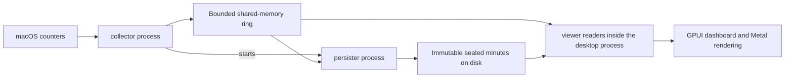
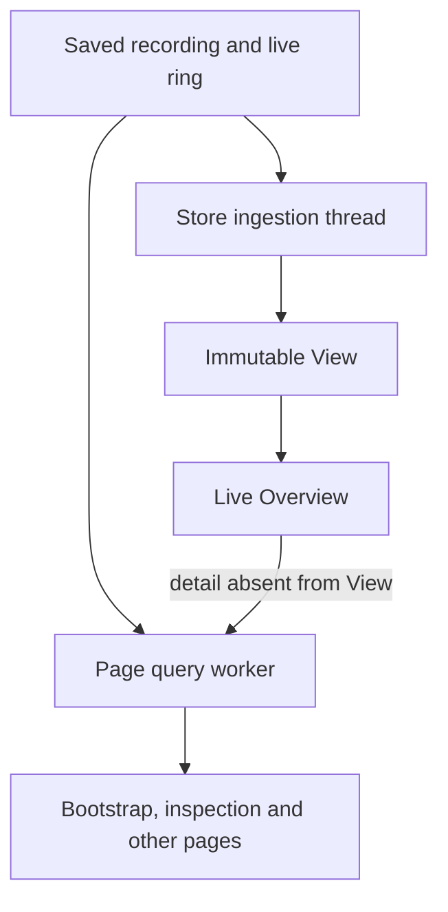
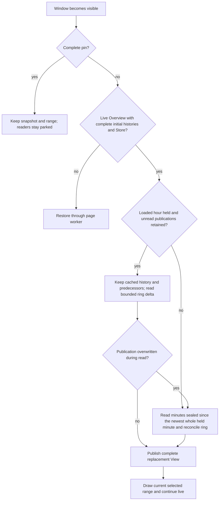

# Flightdeck architecture

Flightdeck separates collecting the Mac's readings, saving them, interpreting them,
and drawing them. Closing the normal live window leaves collection running. The
window's readers can stop doing work without stopping the recording.

Start with the [glossary](../GLOSSARY.md) for domain terms and the
[root README](../README.md) for building and running the app.
[Recording research](recording-research.md) covers the wider design and capabilities
still to build.

## Processes and data flow

The collector samples once a second without root and publishes into a bounded ring.
The separate persister reads it and writes immutable Parquet windows, normally one
minute each. The ring covers recent publications; the recording supplies older
history and recovery after a reader falls behind. A recording continues across
collector runs. Run, boot and publication identities distinguish observations,
including observations that share a wall-clock second.

The desktop attaches to an existing compatible collector or starts one when needed.
It stops only a collector it started. Opening a saved recording with `--recording`
is read-only unless collection is explicitly requested. Collector ownership and
window visibility are separate lifecycles.

| Part | Responsibility | Starting point |
| --- | --- | --- |
| `model` | Shared data types | [`model/src`](../model/src) |
| `collector` | macOS acquisition, process tracking, ring publication and recording registration | [Collector guide](collector.md), [`collector/src`](../collector/src) |
| `persister` | Separate executable that saves collected readings | [`persister/src/main.rs`](../persister/src/main.rs) |
| `persistence` | Saved layout, bounded admission, Parquet encoding and query execution | [`persistence/src/lib.rs`](../persistence/src/lib.rs) |
| `viewer` | Recording interpretation, identities, rates, App histories and live Store | [`viewer/src/lib.rs`](../viewer/src/lib.rs) |
| `desktop` | Native lifecycle, selection, reader orchestration, presentation and rendering | [Desktop guide](../desktop/README.md), [`desktop/src/main.rs`](../desktop/src/main.rs) |

The root Cargo workspace contains the recording core and tools. The desktop has its
own workspace and lockfile so UI dependencies stay separate. It depends on the core
through local path dependencies. Viewer presentation code may allocate within its
bounds; the collector's acquisition loop follows the stricter startup-allocation
rules in [Tiger Style](tiger-style.md).

## Collection and persistence boundaries

The acquisition thread owns process watches, startup-sized buffers and ring publication.
Between one-second deadlines, kqueue wakes it for process lifecycle events. A full event
buffer rejects optional payload work before acquisition while retaining watch maintenance
and loss counts. PID scans fill existing capacity without clearing unused storage.

Tick numbers describe the one-second schedule; publication numbers count actual writes to
the ring. A delayed observation skips the missed tick numbers and retains its acquisition
timestamps. Consumers can distinguish collection gaps from overwritten publications and
withhold rates across a gap. The collector never fills missed deadlines with catch-up reads.

Each IOReport and SMC reader owns the validity of its current reading. It invalidates that
reading before acquisition and exposes it only after the whole read succeeds. A returned
read error leaves that source unavailable for the tick, while other sources continue. The
reader retains its handle and buffers for the next tick; partial updates cannot escape as
fresh readings. A native call that hangs can still block the acquisition thread.

Each collector or persister process sends diagnostics through a fixed-capacity queue to
its own output thread. The producer never waits for the destination; overload loses reports
with explicit counters. Slow diagnostics therefore do not control the recording's progress.

The persister first reads timing and completion information to decide whether a window is
ready. Only then does it allocate payload buffers, copy the readings and encode them. It
still admits and maps the source on each pass, and releases that mapping before encoding.
Its memory watchdog stays active between operations, including while the main worker waits.

New process and App GPU time remains unavailable because the inspected native client
counters cannot establish process-creation ownership. Machine GPU measurements and existing
recorded GPU values remain supported. The [collector guide](collector.md) explains these
boundaries, recovery, diagnostic delivery and remaining resource limits in detail.

## Two reading paths inside the desktop

Live Overview uses `viewer::store::Store` to retain machine and App readings and
publish immutable `View`s. The Store owns its ingestion thread and bounded buffers.
The UI projects a View into charts and readouts without querying the recording on
the UI thread.

The page worker wraps `viewer::LiveSession`. It handles initial snapshots, exact
inspection, saved recordings, other resource pages and details not retained in a
View. Its request and result mailboxes each have capacity one. Cancellation
generations prevent an old answer replacing a newer selection.

Once Overview has complete initial histories and follows a Store View, its page
worker rests. A hover retained in the View reads there; a missing detail can request
the worker. The Store continues ingesting while another page follows the live Mac,
keeping its newest View ready for a return to Overview. A hidden window parks the Store,
and so does a held second, whether from Pause, a range dragged on a chart or a pinned
observation, and a saved recording shown in a live window. Bootstrap, incomplete
histories and unavailable Store data retain the page-worker path.

The native timer normally takes completed work every 250 ms. While a restoration
or another reply is pending, the live window's scheduling also polls promptly for
that answer. Rendering consumes accepted data; it does not replay a queue of hidden
updates to animate the chart forward.

## Hiding and restoring a window

Visibility and the selected time are independent. A live selection means “follow
the latest reading with this range.” A pin means “keep this exact observation and
this range.” Hiding the window preserves that choice and parks its readers.
Closing the normal live window retains the request, chart range, pin, snapshot and
handed-over worker for reopening while the app keeps running in the background.

| State before hiding or closing | Restore behavior |
| --- | --- |
| Live Overview, five minutes selected | Keep five minutes selected, reconcile to the newest endpoint and continue live |
| Live Overview, another range selected | Preserve that range and follow the newest endpoint |
| Complete pinned snapshot | Keep the exact observation and range without a live read |
| Pin with incomplete histories and a running reader, or with no retained snapshot | Restore that selected observation through the page worker without ingesting new live arrivals |
| Pin with a retained snapshot whose reader stopped | Keep the snapshot and range without a new request; canceled histories are no longer pending |
| Another page or incomplete initial Overview | Restore through the existing page-worker path |

Checkpoint reuse requires the same recording and registered ring identity, a
contiguous unread cursor still inside ring retention, and every saved second of the loaded
hour, the newest 3,600 s of readings, held. The Store holds that hour whatever range is
selected, so a range switch leaves its readings as they are. An expired checkpoint reads
the newest sealed minute the Store holds whole, to seed rates, and every minute the
recording sealed after it. Where the Store holds no whole sealed minute of that run, it
loads the whole hour again. During restoration the Store withholds partial Views until
it reaches the current endpoint, or reports a failure. Missing or refused readings
remain explicit gaps in the replacement. While the held hour leaves a minute out, each
expired checkpoint reads the whole hour again, so a minute that becomes readable fills it.

Coverage is checked again through consumption. If the writer overwrites an unread
publication after checkpoint admission, the Store withholds the incomplete View,
invalidates coverage and switches to reading the sealed minutes. Checking coverage
only before reading would silently omit a reading still recoverable from disk.

Overview waits for that replacement instead of submitting a duplicate full-period
page query. The Store's pending state keeps restoration scheduled until its answer
arrives.

## Why this reduces work

A covered resume keeps already interpreted history and the raw predecessors used
to calculate rates. It reads only the unread ring delta. A gap beyond ring retention
reads the minutes sealed during it rather than every intermediate publication. Past
about half an hour that costs about what reloading the whole hour does, as the
[measurements](window-resume-performance.md) show.
The independent page worker stays idle when the Store supplies Overview.

Catching up still needs predecessor data to derive correct first-successor rates.
The terminal decoder validates the saved predecessor minute, including refused
observations, and retains its terminal raw predecessor without constructing App
presentation objects. Dropping validation would change which later rates are valid.

The [window-resume performance report](window-resume-performance.md) contains the
profiles, before/after measurements, memory tradeoff and reproduction protocol.
Its warm-cache CPU-frame bounds exclude GPU display latency and do not establish
cold-storage performance or a percentile latency target.

## Where to trace a change

| Question | Source and behavioral checks |
| --- | --- |
| Who starts, attaches to or stops collection? | [`live_launch.rs`](../desktop/src/live_launch.rs), [`live_launch_tests.rs`](../desktop/src/live_launch_tests.rs) |
| What survives closing the window? | [`live_background.rs`](../desktop/src/live_background.rs), [`live_background_tests.rs`](../desktop/src/live_background_tests.rs) |
| When do readers park, resume or hand over? | [`live_dashboard.rs`](../desktop/src/live_dashboard.rs), [`live_source_visibility_tests.rs`](../desktop/src/live_source_visibility_tests.rs) |
| Which View can Overview accept and inspect? | [`live_store_view.rs`](../desktop/src/live_store_view.rs), [`live_store_view_tests.rs`](../desktop/src/live_store_view_tests.rs) |
| When can a checkpoint be reused or reloaded? | [`store.rs`](../viewer/src/store.rs), [`store/ring.rs`](../viewer/src/store/ring.rs), [`store/resume_tests.rs`](../viewer/src/store/resume_tests.rs) |
| How do saved ticks seed valid rates? | [`store/recording.rs`](../viewer/src/store/recording.rs), [`recording/processes.rs`](../viewer/src/recording/processes.rs), [`store/recording_payload_tests.rs`](../viewer/src/store/recording_payload_tests.rs) |
| How are requests cancelled and exact identities preserved? | [`live_source.rs`](../desktop/src/live_source.rs), [`live_source_tests.rs`](../desktop/src/live_source_tests.rs) |

For development checks use the [root README's Check section](../README.md#check).
The CI workflow runs `just check-root` and `just check-desktop`. The
[native verification record](../desktop/LIVE.md) distinguishes automated checks
from observations that still require an interactive Mac session.
