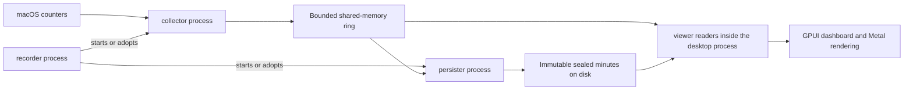
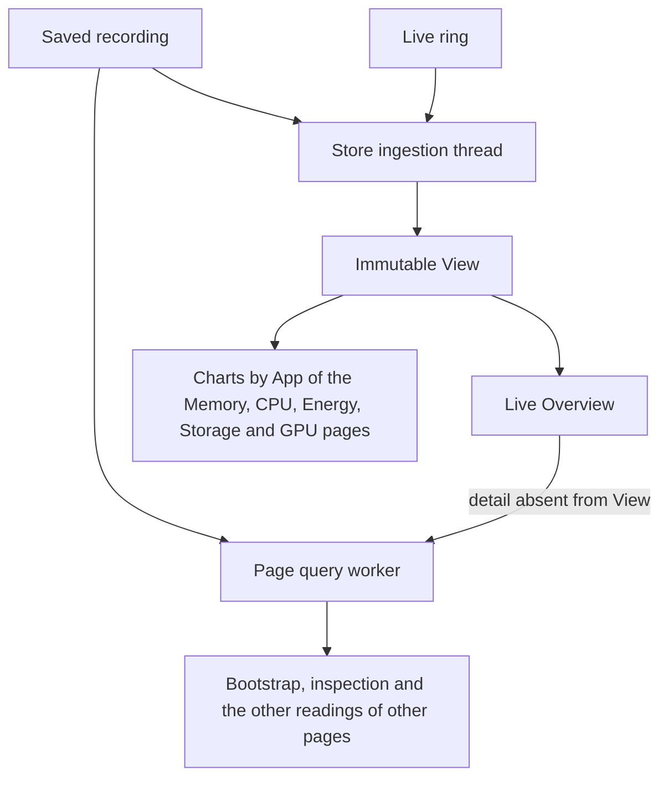
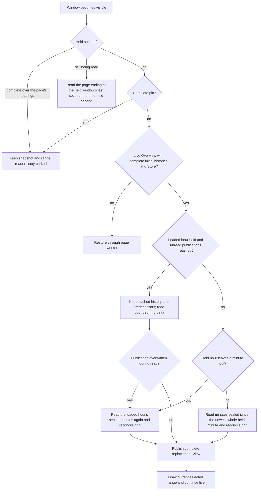

# Flightdeck architecture

Flightdeck separates collecting the Mac's readings, saving them, interpreting them,
and drawing them. Closing the normal live window leaves collection running. The
window's readers can stop doing work without stopping the recording.

Start with the [glossary](../GLOSSARY.md) for domain terms and the
[root README](../README.md) for building and running the app.
[Recording research](recording-research.md) covers the wider design and capabilities
still to build.

## Processes and data flow

The collector samples once a second without root and publishes into a bounded ring.
The separate persister reads it and writes immutable Parquet windows, normally one
minute each. The ring covers recent publications; the recording supplies older
history and recovery after a reader falls behind. A recording continues across
collector runs. Run, boot and publication identities distinguish observations,
including observations that share a wall-clock second.

The desktop attaches to an existing compatible recording or starts its recorder when needed.
Closing or quitting the GUI detaches from the recorder; acquisition and saving continue. Opening a saved recording with `--recording`
is read-only unless collection is explicitly requested. Collector ownership and
window visibility are separate lifecycles.

| Part | Responsibility | Starting point |
| --- | --- | --- |
| `model` | Shared data types | [`model/src`](../model/src) |
| `collector` | macOS acquisition, process tracking, ring publication and recording registration | [Collector guide](collector.md), [`collector/src`](../collector/src) |
| `recorder` | Worker lifecycle, bounded retries, adoption, explicit stop and combined cost reporting | [`collector/src/bin/recorder.rs`](../collector/src/bin/recorder.rs) |
| `persister` | Separate executable that saves collected readings | [`persister/src/main.rs`](../persister/src/main.rs) |
| `persistence` | Saved layout, bounded admission, Parquet encoding and query execution | [`persistence/src/lib.rs`](../persistence/src/lib.rs) |
| `viewer` | Recording interpretation, identities, rates, App histories and live Store | [`viewer/src/lib.rs`](../viewer/src/lib.rs) |
| `desktop` | Native lifecycle, selection, reader orchestration, presentation and rendering | [Desktop guide](../desktop/README.md), [`desktop/src/main.rs`](../desktop/src/main.rs) |

The root Cargo workspace contains the recording core and tools. The desktop has its
own workspace and lockfile so UI dependencies stay separate. It depends on the core
through local path dependencies. The desktop and viewer may allocate. Their memory must
be bounded by the span of readings they retain rather than process uptime, as required
by [the coding style](coding-style.md). The collector's acquisition loop follows its
stricter startup-allocation rules.

## Collection and persistence boundaries

The acquisition thread owns process watches, startup-sized buffers and ring publication.
Between one-second deadlines, kqueue wakes it for process lifecycle events. A full event
buffer rejects optional payload work before acquisition while retaining watch maintenance
and loss counts. PID scans fill existing capacity without clearing unused storage.

Tick numbers describe the one-second schedule; publication numbers count actual writes to
the ring. A delayed observation skips the missed tick numbers and retains its acquisition
timestamps. Consumers can distinguish collection gaps from overwritten publications and
withhold rates across a gap. The collector never fills missed deadlines with catch-up reads.

Each IOReport and SMC reader owns the validity of its current reading. It invalidates that
reading before acquisition and exposes it only after the whole read succeeds. A returned
read error leaves that source unavailable for the tick, while other sources continue. The
reader retains its handle and buffers for the next tick; partial updates cannot escape as
fresh readings. A native call that hangs can still block the acquisition thread.

Each recorder, collector or persister process sends diagnostics through a fixed-capacity queue to
its own output thread. The producer never waits for the destination; overload loses reports
with explicit counters. Slow diagnostics therefore do not control the recording's progress.

The recorder holds only the controller lock. Workers hold their own acquisition and commit
locks and publish separate fixed-size health records with native process creation identity.
The private mapping also binds the recording, cohort authority and source compatibility
fingerprint. Durable health advances after canonical commit synchronization. Recorder loss
leaves healthy workers running; a relaunch verifies survivors before adopting them.
A persister operating failure receives bounded retries while acquisition continues.

The persister first reads timing and completion information to decide whether a window is
ready. Only then does it allocate payload buffers, copy the readings and encode them. It
still admits and maps the source on each pass, and releases that mapping before encoding.
Its memory watchdog stays active between operations, including while the main worker waits.

Recording roots declare separate reader and writer protocol requirements. Readers and writers
refuse a root of an older format rather than convert it in place, and the app's default launch
deletes an older recording that no process holds to make a new one. Within one sealed window, Events is one logical table backed by bounded physical
parts and an index under the same canonical commit. Readers bind each opened part to the
captured file identity before decoding, then validate row identity and provenance before
exposing a budgeted frame.

Recovery also preserves events whose observations have left the ring. Such rows retain
their native identity and event number, with an explicitly unavailable publication. They
remain visible to raw queries and do not become App frames. A completed source with no
recoverable observations commits an event-only object, discoverable through the terminal
discovery and paging APIs. The ordinary saved-recording Session does not yet expose those
objects as a selectable inspection source.

New process and App GPU time remains unavailable because the inspected native client
counters cannot establish process-creation ownership. Machine GPU measurements and existing
recorded GPU values remain supported. The [collector guide](collector.md) explains these
boundaries, recovery, diagnostic delivery and remaining resource limits in detail.

## Two reading paths inside the desktop

`viewer::store::Store` retains the live Mac's machine and App readings and publishes
immutable `View`s. The Store owns its ingestion thread and bounded buffers. Live
Overview projects a View into its charts and readouts, and the Memory, CPU, Energy,
Storage and GPU pages draw their chart by App from one, without querying the recording
on the UI thread.

The page worker wraps `viewer::LiveSession`. It handles initial snapshots, exact
inspection, saved recordings, every other reading of the pages other than live Overview,
and details not retained in a View. Its request and result mailboxes each have capacity one. Cancellation
generations prevent an old answer replacing a newer selection.

Once Overview has complete initial histories and follows a Store View, its page
worker rests. A hover retained in the View reads there; a missing detail can request
the worker. The Store continues ingesting while another page follows the live Mac. Once
the worker has answered them, the Memory, CPU, Energy, Storage and GPU pages draw their
chart by App from the newest View no older than the worker's readings, since the worker's
App histories stop 960 s back and the View holds every App's ten-second sums for the
loaded hour. Their other charts, and every chart of the other pages, come from the
worker. A hidden window parks the Store, and so does a saved recording shown in a live
window, while a selected or held second leaves it taking in the live Mac. Bootstrap, incomplete histories and unavailable Store
data retain the page-worker path.

A held second is a second of the live Mac that the page holds after a click on a chart,
Return on a second reached with the arrow keys, Enter on the CPU heatmap, Pause, or a
range dragged on a chart. The page keeps the last second of the window it showed then, so
the charts keep their window, and the newest View it took, so a range picked while held
redraws the charts by App from that View without reading the recording. Each read it asks
of the worker meanwhile is the page whose context ends at that last second, or the held
second's own reading. Letting go drops the View, which frees its buffers, and the page shows
what it drew from the View until the Store's next View.

The native timer normally takes completed work every 250 ms. While a restoration
or another reply is pending, the live window's scheduling also polls promptly for
that answer. Rendering consumes accepted data; it does not replay a queue of hidden
updates to animate the chart forward.

## Hiding and restoring a window

Visibility and the selected time are independent. A live selection means “follow
the latest reading with this range.” A pin means “keep this exact observation and
this range.” A held second means “keep this second and the seconds the charts showed
when it was held.” Hiding the window preserves that choice and parks its readers.
Closing the normal live window retains the request, chart range, pin or held second,
snapshot and handed-over worker for reopening while the app keeps running in the
background. A held second also keeps its View through a hide and a close, so the charts
drawn again show the seconds they showed when it was held.

| State before hiding or closing | Restore behavior |
| --- | --- |
| Live Overview, five minutes selected | Keep five minutes selected, reconcile to the newest endpoint and continue live |
| Live Overview, another range selected | Preserve that range and follow the newest endpoint |
| Held second whose reading is complete over the page's readings | Keep the held second, its window and its View without a read |
| Held second whose reading is still being read, or whose page has no readings yet | Read the page whose context ends at the held window's last second, then the held second's own reading |
| Complete pinned snapshot | Keep the exact observation and range without a live read |
| Pin with incomplete histories and a running reader, or with no retained snapshot | Restore that selected observation through the page worker without ingesting new live arrivals |
| Pin with a retained snapshot whose reader stopped | Keep the snapshot and range without a new request; canceled histories are no longer pending |
| Another page or incomplete initial Overview | Restore through the existing page-worker path |

Checkpoint reuse requires the same recording and registered ring identity, a
contiguous unread cursor still inside ring retention, and every saved second of the loaded
hour, the newest 3,600 s of readings, held, apart from the seconds of a minute that refused
to load, which a reused checkpoint does not read again. The Store holds that hour whatever range is
selected, so a range switch leaves its readings as they are. An expired checkpoint reads
the newest sealed minute the Store holds whole, to seed rates, and every minute the
recording sealed after it. Where the Store holds no whole sealed minute of that run, it
loads the whole hour again. During restoration the Store withholds partial Views until
it reaches the current endpoint, or reports a failure. Missing or refused readings
remain explicit gaps in the replacement. While the held hour leaves a minute out, each
restoration the checkpoint does not cover reads the whole hour again, so a minute that
becomes readable fills it then.

Coverage is checked again through consumption. If the writer overwrites an unread
publication after checkpoint admission, the Store withholds the incomplete View,
invalidates coverage and reads the loaded hour's sealed minutes again, since the seconds it
took after the overwritten one would otherwise stand past a gap. Checking coverage
only before reading would silently omit a reading still recoverable from disk.

Overview waits for that replacement instead of submitting a duplicate full-period
page query. The Store's pending state keeps restoration scheduled until its answer
arrives.

## Why this reduces work

A covered resume keeps already interpreted history and the raw predecessors used
to calculate rates. It reads only the unread ring delta. A gap beyond ring retention
reads the minutes sealed during it rather than every intermediate publication. Past
about half an hour that costs about what reloading the whole hour does, as the
[measurements](window-resume-performance.md) show.
The independent page worker stays idle when the Store supplies Overview.

Catching up still needs predecessor data to derive correct first-successor rates, so
the load decodes the newest sealed minute the Store holds whole along with the minutes
after it, and takes in only the seconds it does not hold. Starting at the first new
minute would change which of its rates are valid.

The [window-resume performance report](window-resume-performance.md) contains the
profiles, before/after measurements, memory tradeoff and reproduction protocol.
Its warm-cache CPU-frame bounds exclude GPU display latency and do not establish
cold-storage performance or a percentile latency target.

## Where to trace a change

| Question | Source and behavioral checks |
| --- | --- |
| Who starts, attaches to or stops collection? | [`live_launch.rs`](../desktop/src/live_launch.rs), [`live_launch_tests.rs`](../desktop/src/live_launch_tests.rs) |
| What survives closing the window? | [`live_background.rs`](../desktop/src/live_background.rs), [`live_background_tests.rs`](../desktop/src/live_background_tests.rs) |
| When do readers park, resume or hand over? | [`live_dashboard.rs`](../desktop/src/live_dashboard.rs), [`live_source_visibility_tests.rs`](../desktop/src/live_source_visibility_tests.rs) |
| Which View can a page accept, draw and inspect? | [`live_store_view.rs`](../desktop/src/live_store_view.rs), [`live_store_view_tests.rs`](../desktop/src/live_store_view_tests.rs) |
| What does a held second keep, and what lets it go? | [`live_hold.rs`](../desktop/src/live_hold.rs), [`live_hold_input_tests.rs`](../desktop/src/live_hold_input_tests.rs) |
| When can a checkpoint be reused or reloaded? | [`store.rs`](../viewer/src/store.rs), [`store/ring.rs`](../viewer/src/store/ring.rs), [`store/resume_tests.rs`](../viewer/src/store/resume_tests.rs) |
| How do saved ticks seed valid rates? | [`store/recording.rs`](../viewer/src/store/recording.rs), [`recording/processes.rs`](../viewer/src/recording/processes.rs), [`store/recording_payload_tests.rs`](../viewer/src/store/recording_payload_tests.rs) |
| How are requests cancelled and exact identities preserved? | [`live_source.rs`](../desktop/src/live_source.rs), [`live_source_tests.rs`](../desktop/src/live_source_tests.rs) |

For development checks use the [root README's Check section](../README.md#check).
The CI workflow runs `just check-root` and `just check-desktop`, with the persistence
package's tests and `just test-event-capacity` in jobs of their own. The
[native verification record](../desktop/LIVE.md) distinguishes automated checks
from observations that still require an interactive Mac session.
