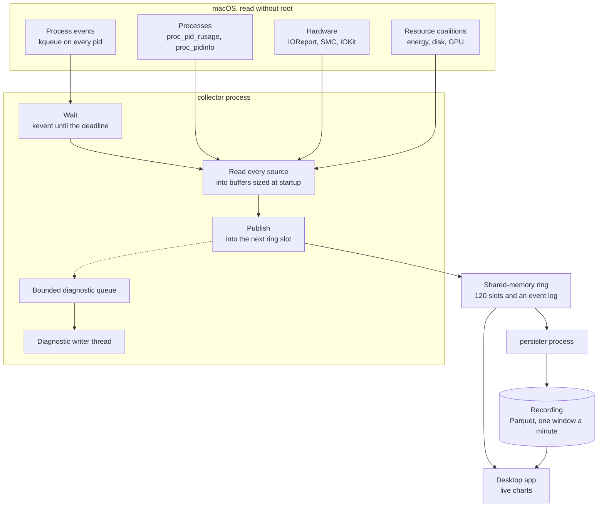
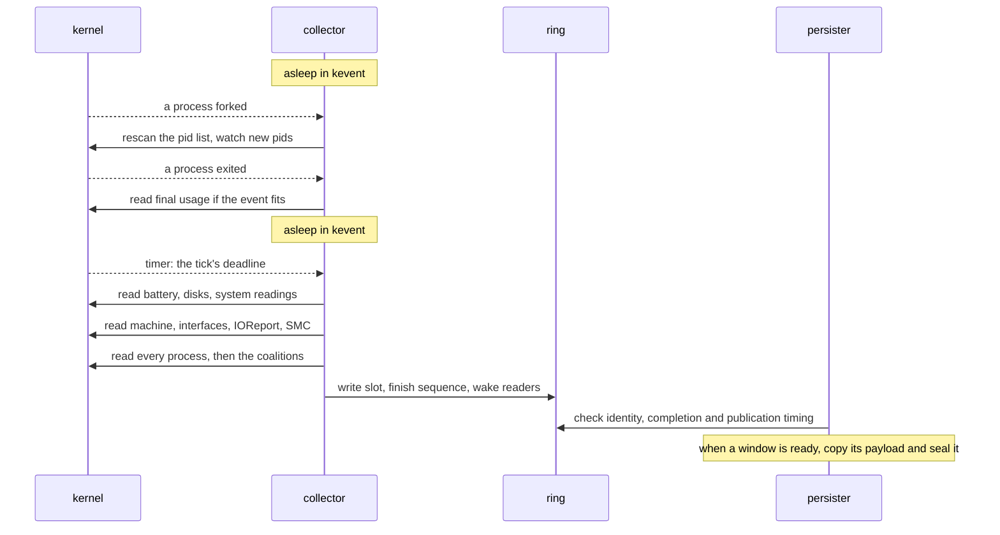

# How the collector works

The collector reads the Mac and every process once a second, without root, and hands each
tick to whoever wants it. A separate persister saves those ticks as the recording, and the
desktop app draws them live. This page describes how the parts fit together, what happens
in one tick, and why each part is built the way it is. The measurements behind the choices
are in [recording-research.md](recording-research.md), and this page names the section each
number comes from. [Terms](#terms) explains the macOS calls and the parts of the ring and the
recording that the page names. How to build, run and inspect the collector is in the
[README](../README.md#collector).

## The parts

There are two programs and one shared object between them.

One acquisition thread asks the kernel for readings and writes each tick into the ring.
It never waits for a reader and never writes a file of readings itself. A separate diagnostic
thread writes reports from a bounded queue, so a blocked output destination cannot stop
acquisition. The collector starts the persister and a marker child at the start and end of
a run, whose pids bound the count of processes it missed.

The ring is a POSIX shared-memory object that only the user can open. It holds the last 120
published ticks, normally two minutes, and a log of process events beside them. Any process
of the same user can map it read-only and read at its own pace.

The persister is a child the collector starts once at startup. It reads the ring and seals
each window of 60 elapsed seconds into immutable Parquet files, the sealed minutes of the
recording. The desktop app combines those sealed minutes with the ticks the ring holds that
are not sealed yet, which is roughly the minute in progress, so the newest seconds come from
memory and everything older from disk.

## One tick

Each tick has an absolute deadline, a whole number of seconds after the run started, on
`mach_continuous_time`. That clock keeps counting while the Mac sleeps, so a sleep shows up
as slipped ticks rather than as a pause in the clock. The collector registers the deadline as
a kqueue timer and sleeps in `kevent` until it fires. The acquisition thread uses no CPU
while asleep; the diagnostic writer may still be delivering a report. The
same kqueue carries a watch on every process, so a fork, an exec or an exit wakes it early to
handle that event, and it goes back to sleep until the deadline.

When the deadline fires, the collector takes the tick's clocks and reads, in this order: the
battery, which it refreshes only once every 60 seconds; the disks; the system readings, such
as the load average, open files, thermal pressure, GPU memory and each core's clocks;
the machine's counters; the network interfaces; IOReport's frequency
states and the GPU's energy; and the SMC's temperatures and fans. Then it lists every pid,
reads each process's usage, drains the process events of the tick, and reads the resource
coalitions those processes belong to. Every reading of the tick carries the same tick number
and the clocks taken at its start, so readings of one second join on equality.

New process and App GPU readings are unavailable. The GPU driver's client counters name
only a PID, which cannot establish the owning process after PID reuse. The collector
therefore skips this acquisition. Machine GPU activity, energy and memory, and resource
coalition readings remain available. Existing recordings retain their recorded values.

It then writes the tick into the next slot of the ring and wakes any reader waiting on it.
If a wait runs past additional deadlines, a regular observation takes the tick number of
the most recent deadline already reached. The missed ticks leave a gap before it, so its App
rates are unavailable and a valid consecutive successor can recover rates. The clocks still
record when acquisition started. The special startup warm-up remains tick 0.

If acquisition runs past later deadlines, the observation keeps its starting tick number
and clocks; the next tick is the first deadline still ahead after the work finishes. Both
kinds of skipped ticks count as slips and have no readings. The collector takes one
observation per acquisition and does not fill gaps with catch-up readings.

Every 10 ticks and every 60 the collector submits a report of its own cost, broken down by
source. The minute report gives the CPU of the collector and the persister together as a
share of one core, to compare with the budget below.

## Following processes between ticks

Most processes that start and exit on a Mac live for milliseconds. In one measured minute,
2,007 of the 2,016 processes that started and exited lived under a second, with a median of
6 ms (Process starts and exits without root). A read once a second sees almost none of them.

The collector places a kqueue watch (`EVFILT_PROC` with `NOTE_FORK`, `NOTE_EXEC` and
`NOTE_EXIT`) on every process. macOS allows that without root, on other users' processes
too. The kernel no longer names the child of a fork (`NOTE_TRACK` is unsupported), so a fork
only says that some parent forked. The collector answers it by listing the pids again,
comparing the list with the one it knows, and watching each new pid. An exec or an exit
starts no rescan. The README describes `--rescan-ms`, which limits how often a burst of forks
rescans.

Each rescan reuses the PID buffer allocated at startup. The native call fills its spare
capacity, and the collector exposes only the returned, count-checked and PID-validated
prefix. It does not clear the unused suffix before another scan. This removes redundant
memory writes without changing the default rescan cadence or the set of listed processes.

When a process exits, its final usage stays readable until its parent reaps it, so the
collector reads it on an admitted exit event. A process a rescan finds already gone is read
then if the event fits and its usage is still readable. In five-minute research runs the
collector read the final usage of 82 to 84% of the processes that exited (Process starts and
exits without root).

A tick holds at most 16,384 process events. A burst past that drops the rest and counts the
dropped events by kind in the tick, so a reader knows what is missing. One admission point
checks capacity before optional Start/Exit payload acquisition and dictionary insertion.
Rejected events still update watch lifecycle and loss accounting. After a tick that
dropped a start, the collector reads the coalition of every listed process, not only the new
ones, so it still learns the coalitions of the processes whose starts it dropped.

Admitted start events and the scheduled identity sweep read executable paths with
`proc_pidpath`. Verified paths enter a dictionary in the ring, which the persister saves
with the process's readings. A rejected start event does not consume a dictionary entry.
An App, as the glossary defines it, comes from the outermost `.app` bundle in that path.

## The ring

The collector writes and every reader only reads. A reader copies a slot, then checks the
slot's sequence word again, as a single-writer seqlock does. If the writer overwrote the slot
during the copy, the reader drops that copy instead of reading it torn. Each slot carries a
publication number that rises by one a slot, so a reader that fell behind knows exactly which
publications it missed, and tells them apart from ticks the collector slipped, which are a gap
in tick numbers alone.

The writer wakes readers once a tick with `os_sync_wake_by_address_all` on a word of the ring,
which reaches every process that maps it, read-only mappings included. The persister does not
use the wake. It looks at the ring once a second, since it only needs to keep up within two
minutes.

Process events go to a log of their own beside the slots, so a tick with many events
overwrites no other tick. Each slot names the range of events that belong to it.

The ring is sized when it is made for every process and coalition the collector's limits
allow. Its exact size depends on those capacities and its format. The native run measured
on 2026-10-26 reserved 1,025,585,336 bytes, about 978 MiB of virtual address space. In the
current identity layout, the event region alone reserves
`120 × 16,384 × 24 × 8 = 377,487,360` bytes, or 360 MiB.

The event log advances around that whole region as events arrive. Long-running churn can
therefore touch all of its backing even when a much smaller recent history is useful.
Virtual reservation, touched backing, resident memory, physical footprint and compressed or
swapped pages are different quantities; touching every page does not prove they all remain
resident together. Reusing event storage by retained tick is planned with the ring redesign,
and is not implemented. The ring's name carries 60 random bits written only to the lock file,
so another user cannot guess it (Security). The lock file
also stops a second collector from writing the same ring.

## The persister and the recording

While waiting for a window to become ready, the persister reads sequence-protected timing
and status fields instead of decoding full process, event and machine payloads. It allocates
the shape-sized Tick buffer and stages readings only when a window is ready to seal. Each
pass still reads the registry, admits and maps the source, checks the producer and looks up
saved progress. A waiting pass drops its reader; no reader cache is retained across passes.
The staging scope also drops the mapping before encoding begins.

Recovery advances by publication number. If publications are overwritten during scanning
or staging, it preserves surviving unsealed readings and records the loss instead of
skipping the rest of that window. A completion marker is checked against the publication
frontier before the source is retired, so completion cannot hide a final publication.

The persister seals each window of 60 elapsed seconds into one Parquet file per table, sorted
by series and compressed with Zstandard. Two of those tables, the per-App ranks and parts, are
derived from the others as the window seals. A window becomes visible through a commit marker
written only once every table of it is synced to disk, so a reader never sees half a minute.
The persister checks its current and kernel lifetime-peak physical footprint every 100 ms
against a limit, 2 GiB by default, and exits if either exceeds it. That is a threshold it
may overshoot, not a quota macOS enforces.
This watchdog keeps checking between sealing operations because native allocations can
outlive an operation. It also enforces active-operation deadlines. Parking it while the
worker waits would weaken that protection, so its nominal ten checks a second remain.

## Diagnostics cannot hold up recording

The collector and persister install separate process-local diagnostic services at startup.
If a writer cannot start, reporting is disabled without preventing recording.
Each producer formats into fixed storage and attempts to submit a complete group using
nonwaiting locks. Four queue slots each hold up to 8 KiB. A full queue, contention or an
oversized group drops that diagnostic group and increments a reason-specific counter;
it does not wait or end collection. The writer parks when there is no work and owns the
potentially blocking writes to duplicated stdout and stderr descriptors.

A failed destination is disabled. Loss summaries go to an available destination when
delivery can proceed, and the desktop reports those gaps rather than treating a missing
cost report as a zero-cost interval. If the writer itself blocks, diagnostic delivery can
stop while ring publication and persistence continue.

Normal exit releases recording resources and reaps the persister before allowing up to
100 ms for final diagnostics. It then exits without waiting indefinitely for the writer.
A fatal watchdog exit makes a nonwaiting reporting attempt and exits immediately.
Diagnostic delivery is therefore best-effort; recorded readings use the ring and sealed
files, not this queue.

## Reading saved history

The live window's store reads sealed minutes back one table at a time with Polars' Parquet
reader, into typed rows and with no SQL, while the rest of the app reads the recording through
Polars SQL. Each table must stay within the recording's admission bounds, and each process and
event row must hold an identity and a usage as the persister writes them, so a damaged or
oversized minute is refused with its reason, never read as zeros. The store takes a minute's
Apps from its App parts where the minute keeps parts of the version this build writes. For a
minute sealed before App parts existed, or with parts of an older version, the decoder derives
the Apps from the minute's processes and events by the rule the seal uses, and over a real
recording of 4,296 minutes on 2026-10-23 both gave the same Apps on all 675 minutes that keep
current parts. The store does not call that derivation yet. An App's rates at a tick come from
the tick just before it in the same run, as the glossary's rate says, so a minute's first tick
takes them from the last tick of the minute before, and a run's minutes derive in order. A
minute derived without the one before it has no App rates at its first tick.

The recording continues across restarts. Each collector run makes a new ring and registers it
with the recording, and the registry keeps the active ring and one earlier one. The persister
seals what an earlier ring still holds before it moves on to the new one, so a collector that
crashed loses only what its ring had already overwritten. A kernel panic or a power loss may
lose the minute not yet sealed, which is an accepted cost. The README covers what happens when
the persister fails or another one owns the recording.

## Stopping and failing

On Ctrl-C, SIGTERM, the end of a `--seconds` run, or the process exit of the app that started
it, the collector stops collecting, waits for the persister to seal its last window, and reaps it. If
the persister takes longer than two minutes it is killed.

A source that fails to open at startup, such as an SMC or IOReport a Mac does not have, is left
out and every other source is recorded. A failed battery or disk read is reported and the tick
goes on. A returned SMC or IOReport read error is reported through the bounded diagnostic queue
and charged to that source. Its whole reading is unavailable for that tick, including any
values acquired before the failure. The collector keeps the connection and buffers for the
next tick's attempt. A complete successful read restores SMC gauges immediately; IOReport
rates need two consecutive successful observations and never bridge a failed tick. There is no
retry within the tick, and a native call that does not return still blocks collection.
A failed read of the machine, the interfaces, the processes or the coalitions ends the run,
as does a metering failure or a failed assertion, since the release build aborts on a panic.
Nothing restarts the collector on its own. The desktop app shows a Retry control when the
collector it started fails, and running as a launch agent is planned but not built.

## Why it is built this way

Each choice below names what was weighed against it and what decided it, or says that it is
still open.

**Read the kernel directly, and start no program while collecting.** Every reading comes from
a system call or a framework call in the collector's own process. A monitor that runs `ps` or
`nettop` each sample pays for a new process, its startup and text parsing on every read, and
`nettop` alone takes about 30 ms of CPU and 5 seconds a run. The research found that reading
the kernel is the cost and moving the data is nearly free (Reading the kernel is what costs
CPU, not moving the data).

**Sleep until a deadline or an event, and never poll.** Waiting in `kevent` on a timer and the
process watches means the collector runs only when there is work. Following processes this way
measured 31 to 139 µs of CPU a fork (Reading the kernel is what costs CPU), and it sees
processes that live a few milliseconds, which a poll of the process table once a second misses.
Rescanning on every fork, rather than at the collector's own pace, is a departure that
[tiger-style.md](tiger-style.md) records, taken because it misses the fewest processes.

**Absolute deadlines at the default quality of service.** A loop that sleeps a second after
each pass drifts: a probe built that way drifted 9 seconds over 300. Deadlines counted from the
start keep one tick number per second, which is what lets readings join. At the default QoS
class ticks started 3.9 ms late on average, and at utility or background 45 to 61 ms late for
the same CPU, so the lower classes save nothing (What is read, and how often).

**Counters make once a second enough.** CPU time, energy, disk bytes, wakeups and page-ins are
counters since a process started, so reading them once a second keeps every total and loses only
the shape inside the second. Gauges such as resident memory lose a peak between reads, which is
the known limit of this rate. Reading everything at 100 ms was estimated at 28 to 48% of a core,
so a faster mode would have to narrow to one process tree (Counters make slower reads lossless
in total, and Reading the kernel is what costs CPU).

**Coalitions catch some of what the process reads miss.** A resource coalition's CPU time,
energy, disk bytes and GPU time include tasks that have exited, and every coalition answers
without root, root's included. So the cost of a short process, or of one that refuses to be read,
lands in its coalition's totals, provided the collector learned that coalition from a process it
listed or saw start. A coalition whose processes are all gone before a rescan is never read, a
coalition with no process left is dropped, and 8 to 74% of the GPU's active time was charged to
no coalition (Coalitions keep what polling misses). The call has no SDK header and its struct
layout comes from XNU's source, so a macOS update can break it.

**Buffers sized at startup, no allocation of its own per tick.** Every buffer the collector owns
is sized at startup from the machine's limits (`kern.maxproc` for the pid list, the core count,
the tracker's event bound) and a tick fills them without growing them, which assertions check.
That bounds collector-owned storage and removes buffer growth from the sampling path. It
does not bound total cost independently of process count or fork rate. Shared-memory backing
can grow as ring pages are touched, as the ring section above says. Several macOS calls
allocate memory of their own on each read: `IOReportCreateSamples`, `host_processor_info`, and the IOKit property
reads behind the disks, the battery and the GPU statistics. No call found gives the IOReport and
CPU readings without root in memory the caller owns (Reading the kernel is what costs CPU), and
the IOKit reads have not been searched for one.

**A shared-memory ring, written here.** One writer and a few readers on one machine at one tick
a second need no broker. A prototype handing 9.8 KB ticks ten times a second measured 53 µs a
tick for a ring writer and reader together, against 80 µs through a Unix socket, and a broker
such as NATS or Kafka adds a process and two socket hops per message (Moving the data). The
writer never waits, so a slow or stopped reader, a viewer under a debugger or a persister waiting
on disk, cannot slow collection. iceoryx2 offers the same pattern in Rust. Its source, read but
not run, keeps a publisher's history inside the publisher's process and by default cleans up a
dead publisher's data, so ticks would die with a crashed collector. The research chose the ring
written here for that reason, and the choice still waits on the user's ruling (Moving the data).

**A separate persister.** Sealing a minute means sorting, encoding and compressing it with
Polars, which takes far more memory and code than collecting does. Running it in its own process
keeps that memory and any failure away from collection, gives it its own memory limit, and lets
each process's CPU be measured on its own. The collector's release binary stays under a
megabyte, while the persister's carries Polars and is over a hundred times larger, and a
persister that dies costs saved history but not live readings.

**Parquet in one-minute windows.** On a synthetic week the research compared sealed Parquet,
sealed DuckDB files and DuckLake. Parquet used the least disk and the least CPU to write, and
needs no catalog that changes (Where it is kept). Sorting each process's values together inside
a window compressed the samples to 0.49 bytes a value with 10-second windows, 0.24 with 60-second
windows and 0.19 with five-minute windows. A minute is half the size of ten seconds, close to
five minutes, and keeps the part only the ring can answer for, and what a crash can lose, to one
minute (Compression).

**Rust.** The user ruled to stay in Rust (Decisions). The comparison behind that ruling found
performance does not decide it: the same sweep of every process and coalition in Zig used 18 µs
a second less user time, while its total CPU varied more between runs of one language than
between the two, since over 90% of it was system time (Rust against Zig).

**Assertions stay on in production.** The release profile keeps overflow checks and aborts on a
panic, following Tiger Style. A collector that finds its own state wrong stops instead of
recording wrong readings, and the persister seals what the ring holds once a collector is
started again.

## Cost and budget

Collection and persistence together get 5% of one core, averaged over each minute (Decisions).
The collector's minute report prints `combined_percent` against that budget, and its per-source
report shows where the collector's share goes. Source meters measure thread CPU, not elapsed
driver-call latency. Use current reports for current cost: older dated research describes
older workloads and builds, including builds without today's source and identity reads.
Diagnostic loss can make those reports incomplete.

The budget is a target, not an enforced CPU cap. Removing discarded-event acquisition,
unused PID-buffer clearing and premature persister payload work reduces specific operations;
it does not establish that every workload stays below 5%. A 2026-10-26 run with 800 generated
starts per second for 30 seconds reported 5.314656% combined minute CPU, with no event-buffer
overflow. Other project activity and monitors were present, so that is a historical observed
breach, not a controlled estimate of the current build's cost. Rescan-policy changes still
need collector completeness and cost benchmarks. Whole-system power, wakeups, long-run memory
and application latency also need separate measurements.

In the research's runs, IOReport was the most expensive source read every tick, then the sweep of
every process and the coalitions, and in the busier run process tracking cost more than those
three together. Tracking dominates in a burst of forks. A generator aiming at 1,600 forks a second
fell behind and forked in bursts of up to 2,932 a second, and took the collector to 9.9% of a core
over that minute. A minute holding a 30-second burst of 1,744 forks a second cost 4.87 to 8.1%,
and `--rescan-ms 5` brought the same minute to 2.7 to 2.8% at the price of missing more of the
short processes (Decisions).

On an M5 Pro on 2026-10-22, CPU time divided by elapsed time from `ps`, over the first 16 minutes
of a collector the app started, gave 2.86% of a core for the collector and 1.65% for the
persister, 4.5% together.

`persister/src/bin/seal_bench.rs` seals synthetic windows of 1,050 processes through the
persister's own code and prints the median CPU of a seal
and of its derivation, so a change to sealing is measured without a live collector. Deriving each
window's App ranks and App parts replays the window's processes and events as the persister
staged them in memory, and writes two more tables. On an M5 Pro on 2026-10-22 a seal took a
median 135 ms of CPU, 84 ms of it deriving, against 219 ms and 146 ms for a build that re-read
the window's written tables to derive them.
A profile of the seal puts about 15 ms in reading each process's sample and 10 ms in the
derivation's queries and frames.
These observations do not attribute the remaining CPU cost of current waiting passes.

The pages are compressed with zstd at level 3. Re-encoding 20 sealed windows of a real recording,
whose tables take 0.94 MB a window, compression cost about 8 ms of a window's 37 ms of writing,
and about 18 ms of a 192 ms seal in the bench, both measured under a load average near 100.
Level 1 cost the same CPU and made the files 7% larger. lz4 saved most of that CPU and made the
files 43% larger, and leaving the pages uncompressed made them 29 times larger, so the tables
stay at level 3.

The persister writes every column as plain Parquet pages, without a dictionary. Polars' own
writer builds a dictionary for every column, which took about a fifth of a seal's CPU, so the
encoder writes through `polars_parquet` directly. In interleaved runs a seal went from 182 to
144 ms and the files shrank, a window's processes table from 1.58 to 1.27 MB and its App parts
from 826 to 755 kB. Reading a whole table back takes about a quarter longer, 2.2 ms instead of
1.7 for the App parts, and the viewer's page queries cost the same. Keeping dictionaries for the
narrow integer columns cost 13 to 20 ms a seal and read no faster, so no column keeps one.

The persister buffers each table's writes, because Polars hands the file each page header and page on
its own and each of those system calls costs more as the machine's load rises: without the
buffer, a seal of the 2026-10-19 build took about 190 ms on a quiet Mac and 4 to 12 s under a load
average of 15 to 24.

Run side by side on 2026-10-22 for ten minutes, each build on its own scratch ring and empty
recording, the persister spent 1.93 s of CPU against 1.95 s for the 2026-10-19 build, which
derived nothing, about 0.32% of a core each over 11 seals (Overhead in
[headless-collector-research.md](headless-collector-research.md) measured that build at 0.33%).
It reported 205 to 214 MB resident against 89 MB. Resident size and physical footprint measure
different quantities; these observations do not identify which allocator pages explain their
difference or whether those pages are reclaimable. On a scratch collector on 2026-10-23,
the persister's physical footprint, what macOS charges it for
memory, stood at 27 to 29 MB at each minute report between seals and reached 146 MB while
sealing, since a seal builds the whole window's tables at once. The 1.65% above came from a
build that re-read the written tables, as did 0.53 to 0.55% measured once the load average
passed 10, when the 2026-10-19 build spent 1.0 to 1.9%.

## Limits

The collector does not yet read open files, sockets, per-process network bytes or most events.
Without root, about a third of processes, those of other users such as `launchd` and
`WindowServer`, refuse `proc_pid_rusage`. Their starts and exits still arrive through kqueue
and part of their usage through coalition totals. A ring stays in memory or swap after its
collector exits, and the registry keeps at most the active ring and one earlier one. A lock
file lost or rewritten by another program makes the next collector name its rings afresh, and
the rings named under the old lock file stay until the Mac restarts (Security). The retention
period is not built yet, so the recording grows until it is.

## Terms

The [glossary](../GLOSSARY.md) defines the words of the domain this page uses, such as tick,
missed tick, sealed minute, recording, resource coalition and SMC. The words below name the
machinery: the macOS calls the collector makes and the parts of the ring and the recording.
Where a section above says more, the entry points to it.

### Reading macOS

**libproc.** macOS's calls that ask about one process by its pid. `proc_listallpids` lists
every pid, `proc_pid_rusage` gives a process's usage so far, `proc_pidinfo` gives its counts of
threads, faults, system calls and context switches and the coalitions it belongs to, and
`proc_pidpath` gives the path of its executable. They need no root for the user's own
processes. The usage and the counts are refused for the processes of other users, about a third
of all processes.

**`proc_pid_rusage`.** The collector asks for its sixth version (`RUSAGE_INFO_V6`), which gives
a process's CPU time, energy, instructions and cycles, disk bytes read and written, wakeups,
page-ins, resident memory and memory footprint, the figure Activity Monitor shows as a
process's memory. All but the two memory readings are counters since the process started. It
and `proc_pidinfo` together cost about 4 to 12 µs a process.

**Process identity.** macOS reuses pids. Current identity publications carry the kernel's
process unique ID and PID version, verified around usage and executable-path acquisition.
The unique ID distinguishes process creations; the PID version also detects an exec during
acquisition. The program dictionary binds the verified executable to that observation.
Numeric usage still carries its awake-clock start time, which older formats use. Refused or
changed identity is explicit and is never replaced by a PID-only guess.

**sysctl.** macOS's named values about the system, such as `hw.memsize`, `vm.swapusage`,
`kern.memorystatus_vm_pressure_level` and `kern.maxproc`, which the collector reads for the
machine's memory, swap, memory pressure and the most processes it must make room for.

**kqueue and `kevent`.** A kqueue is a queue in the kernel to which a program adds the things
it wants to hear about. `kevent` adds them, sleeps until one fires, and returns what fired. The
collector adds a watch on each pid for fork, exec and exit (`EVFILT_PROC`) and a timer for the
next tick's deadline (`EVFILT_TIMER`), and with `--rescan-ms` a second timer for the delayed
rescan, so one call waits on all of them. Following processes between ticks says how a fork is
answered.

**Reaping.** A process that exits stays in the process table, as a zombie, until its parent
collects its exit status with `wait`. Until then its final usage can still be read.

**The tick's clocks.** Each tick takes three clocks at its start. Wall time is the calendar
time the user sees. Continuous time, `mach_continuous_time`, counts on while the Mac sleeps,
and the tick deadlines and the kqueue timer count on it (`NOTE_MACH_CONTINUOUS_TIME`), so a
change to the wall clock moves no deadline. Awake time, `mach_absolute_time`, stops while the
Mac sleeps, and is the clock of process start times.

**Quality of service class.** The label a thread gives macOS for how urgent its work is, from
user-interactive down to background. The lower the class, the later the research saw the
collector's timer fire, which is why the collector runs at the default class (Why it is built
this way).

**IOReport.** A private Apple framework, with no public header, that gives counters the
kernel's drivers keep. The collector reads three groups of its channels: the time each CPU core
spent in each performance state, the same for the GPU, and from the Energy Model group only the
GPU's energy. Since each channel is a counter, the difference between two reads is what the
second between them spent. Every read allocates inside the framework. The machine's power comes
from the SMC instead.

**IOKit.** Apple's framework for drivers and devices. Its registry holds a node for each
device, whose properties the collector reads for the disks, the battery, the GPU and the cores'
clocks, and it is how the collector reaches the SMC.

### The ring

**POSIX shared memory.** A named object the kernel keeps in memory, made with `shm_open` and
mapped into a process with `mmap`. It is not a file on disk, and it stays until it is unlinked
or the Mac restarts, which is why a ring outlives its collector. The collector maps it to write
and every reader maps it read-only.

**Slot.** One of the ring's 120 places for a tick, so the ring holds the last two minutes. The
collector writes each tick into the slot after the previous one and wraps around at the end.

**Publication.** The number of one write into the ring, which rises by one with each tick
written. Publication `p` lands in slot `(p - 1) mod 120`. A new ring numbers on from the newest
publication of the ring before it, so a reader keeps its place across collector restarts. Tick
numbers skip when the collector slips and publication numbers never skip (The ring).

**Seqlock.** How a reader copies a slot that the writer may be overwriting, without a lock.
Each slot starts with a sequence word, which the writer sets to `2p - 1` before it writes
publication `p` and to `2p` once it has written it. A reader that wants publication `p` reads
the word, copies the slot and reads the word again, and keeps the copy only if both reads gave
exactly `2p`. Anything higher means the writer is writing or has already written a later
publication there, so the reader drops the copy. Anything lower means the ring is broken. The
writer never waits for a reader.

**Event log.** The process events, each start, exec and exit, written in order into a circle of
120 × 16,384 records beside the slots. A start is a pid a rescan found new, so a process started
by `posix_spawn` or found already running has a start and no fork. Each record carries its own
sequence word, read the same way as a slot's.

**Wake.** Once a slot is written the collector calls `os_sync_wake_by_address_all` on a word of
the ring, which wakes every reader waiting in `os_sync_wait_on_address_with_timeout` on that
word, in any process. A reader whose wait macOS refuses looks every 10 ms instead, and the
persister does not wait at all (The ring).

**Lock file.** The file that holds the current ring's name, under the path and `--ring` name the
[README](../README.md#collector) gives. The collector holds an exclusive lock on it while it
runs, and readers find the ring by reading the name from it (The ring).

### The recording

**Window.** The span of 60 elapsed seconds of a run that the persister seals together, one
Parquet file per table, and the final window of a run may be shorter. Windows are kept by run
and by elapsed day, 1,440 windows a day. A sealed window is what the glossary calls a sealed
minute.

**Series.** The readings of one process, coalition or other thing across a window. The persister
sorts each table by its series, the process tables by process identity, so the values of one
series sit together, which is what makes them compress to 0.24 bytes a value (Why it is built
this way).

**Parquet.** A file format that stores a table by column rather than by row, so the values of a
column sit together and compress well, and a query reads only the columns it names. The
persister compresses the columns with Zstandard at level 3 and writes groups of 16,384 rows,
each with the minimum, maximum and null count of every column, so a query can skip a group that
cannot match.

**Polars.** A Rust library for tables in memory. The persister uses it to sort each window's
readings, derive the per-App tables and write the Parquet files. The live window's store reads
sealed minutes back with its Parquet reader, and the rest of the app queries them with Polars
SQL (The persister and the recording).

**App ranks and App parts.** The two tables the persister derives from a window's processes and
events as it seals the window. App ranks hold the Apps that used the most of each resource in
each of the window's ticks, and App parts hold every App's row and processes in each tick. A
window sealed before they existed lacks them, and App parts carry a version, so a reader that
needs the Apps of a window whose parts it does not read derives them from the window's processes
and events (The persister and the recording).

**Commit marker.** A hard link, under the recording's `commits/` directory, to the metadata file
of a window, made once every file of the window is synced to disk. A window belongs to the
recording only once its marker exists (The persister and the recording).

**Registry.** The `runs` file in the recording, which names the active run and at most one
earlier run, with each one's ring and collector pid (The persister and the recording).

## Where the code is

- `collector/src/main.rs`: the tick loop and the reports.
- `collector/src/schedule.rs`: the deadline of each tick.
- `collector/src/publication.rs`: the order of a tick's reads and its publication to the ring.
- `collector/src/collector.rs`: the sources and their fixed capacities.
- `collector/src/tracker.rs`: the kqueue watches, rescans and exit reads.
- `collector/src/processes.rs`, `coalitions.rs`, `ioreport.rs`, `smc.rs`, `machine.rs`,
  `interfaces.rs`, `battery.rs`, `disks.rs`, `system.rs`: one source each.
- `collector/src/programs/`: the executable path of each process.
- `collector/src/ring/`: the ring's layout, writer, readers and wake.
- `collector/src/recording/`: registering a run with the recording and starting the persister.
- `collector/src/cost.rs`: the per-source cost meter behind the reports.
- `collector/src/diagnostics.rs` and `diagnostics/`: bounded report admission and output.
- `persister/` and `persistence/src/worker.rs`: the loop that seals windows from the ring.
- `persistence/src/worker/scanning.rs` and `staging.rs`: timing-only readiness and payload staging.
- `persistence/src/resources.rs`: whole-process memory and operation-deadline protection.
- `persister/src/bin/seal_bench.rs`: the CPU of a seal, measured on synthetic windows.
- `persistence/src/encoder.rs`: how each table is written to Parquet.
- `persistence/src/identity.rs`: the identity and usage a process or event row must hold to be
  read back.
- `viewer/src/recording/`: reading a sealed minute's tables back without SQL, and deriving the
  Apps of a minute whose App parts this build does not read.
